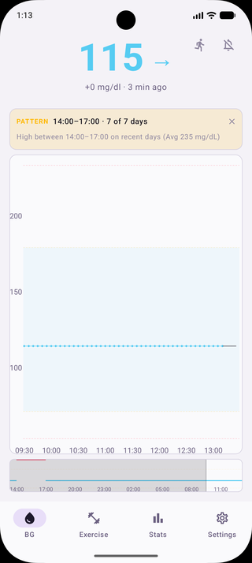
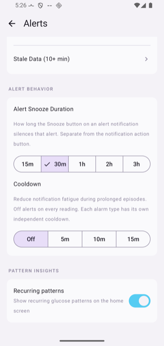

# Alerts

Strimma can alert you with sound and vibration when your glucose crosses configurable thresholds.

---

## Alert Types

Strimma has **eight** alert types, each with its own Android notification channel so you can customize the sound and vibration for each one independently. The Day, Night and Exercise alert sets share the same channels, so each alert has one sound in every set.

### Glucose Threshold Alerts

| Alert | Default Threshold | Bypasses Do Not Disturb | Vibration |
|-------|-------------------|------------------------|-----------|
| **Urgent Low** | 3.0 mmol/L (54 mg/dL) | Yes | Strong, repeated |
| **Low** | 4.0 mmol/L (72 mg/dL) | No | Medium |
| **High** | 10.0 mmol/L (180 mg/dL) | No | Short |
| **Urgent High** | 13.0 mmol/L (234 mg/dL) | Yes | Strong, repeated |

### Predictive Alerts

| Alert | Trigger | Bypasses DND | Vibration |
|-------|---------|-------------|-----------|
| **Low Soon** | Predicted to cross low threshold within prediction window | No | Gentle |
| **High Soon** | Predicted to cross high threshold within prediction window | No | Gentle |

### System Alerts

| Alert | Trigger | Bypasses DND | Vibration |
|-------|---------|-------------|-----------|
| **Stale Data** | No reading received for 10+ minutes. Uses the active set's toggle; suppressed during the first 30 minutes of Workout Mode. See [Workout Mode](workout-mode.md). | No | Gentle |
| **Push Failed** | Nightscout push failed after retries | No | Gentle |

---

## Alert Sets

Strimma has three alert sets. Each set holds its own on/off switch for every alert and its own thresholds.

| Set | When it is active |
|-----|-------------------|
| **Day** | The rest of the time |
| **Night** | During the night window, when **Use night alerts** is on |
| **Exercise** | While Workout Mode is on |

Only one set is active at a time, chosen in this order:

1. If Workout Mode is on, the **Exercise** set is active.
2. Otherwise, if night alerts are on and the time is inside the night window, the **Night** set is active.
3. Otherwise, the **Day** set is active.

Workout Mode takes precedence over night alerts. A workout that starts during the night window uses the Exercise set.

Strimma checks every new reading against the active set. The next reading is checked against the new set. An alert that the new set does not raise is cleared at that check.

---

## Night Alerts

Night alerts replace the Day alerts during a daily time window. You choose, for each alert, whether it is on at night and at which threshold. For example, you can turn off High and High Soon at night if your closed loop corrects highs on its own.

- **Off by default.** Turn on **Use night alerts** in **Settings > Alerts > Alert sets > Night**.
- **Night window.** The window starts at **From** and ends at **To**. The defaults are **23:00** and **07:00**. The window can cross midnight. It includes the **From** minute and excludes the **To** minute. The same window applies every day.
- **Times use your phone's clock.** The window follows your phone's local time, so a daylight-saving change needs no action.
- **No daily action.** Night alerts switch on and off by themselves. Strimma checks each reading against the set for the current time.
- **First enable copies the Day set.** The first time you turn on **Use night alerts**, Strimma copies your Day alerts into the Night set, so turning night alerts on changes no alert. After the copy, the Night set and the Day set are independent.
- **From and To must differ.** Strimma rejects a window whose start equals its end.
- **Shared settings.** Sounds, **Alert Snooze Duration** and **Cooldown** are the same for all three sets.
- **Graph range.** The graph keeps your normal low and high range at night.

While the Night set is active, the four glucose threshold alerts carry a `Night · ` prefix in the title (for example, `Night · Low Glucose`). The Low Soon, High Soon and Stale Data alerts have no prefix.

Night alert settings are part of the settings export and import. The import restores the night set exactly as it was exported. An export file from an older version leaves your current night settings unchanged on import.

---

## Workout-Mode Behavior

When workout mode is on (see [Workout Mode](workout-mode.md)):

- **The Exercise set is selected** instead of the Day or Night set. Its independent enablement toggles, thresholds, predictive toggles, and stale toggle apply (defaults: 5.0 / 6.0 / 14.0 / 16.0 mmol/L).
- **Exercise Low and Exercise High** also become the in-range bounds for graphs and other live displays while Workout Mode is on.
- **Alert titles are prefixed** with `Workout · ` (e.g., `Workout · Urgent Low`) so the severity label is unambiguous — without this, an "Urgent Low" at 5.0 mmol/L could be misread as a normal-life crisis.
- **Stale-data alerts** use the Exercise set's toggle. They are suppressed for the first 30 minutes of Workout Mode, then use the normal 10+ minute rule.

---

## Priority Logic

Alerts follow a priority system to avoid duplicate noise:

- **Urgent Low takes priority over Low.** If your glucose triggers both, only Urgent Low fires. When it rises above the urgent threshold, Urgent Low clears and Low can fire if still below the low threshold.
- **Urgent High takes priority over High.** Same logic — only the more severe alert fires.
- **Predictive alerts only fire when in range.** If you're already low, "Low Soon" won't fire — you already know.

---

## Snooze

When an alert fires, the notification includes a **Snooze** button (label shows the configured duration, e.g. **Snooze 30m**). Tapping it silences that alert and any less severe alerts in the same category for the **Alert Snooze Duration** set in **Settings > Alerts**.

| Option | Effect |
|--------|--------|
| **15m** / **30m** / **1h** / **2h** / **3h** | Silence window for the alert Snooze button |
| Default | **30m** |

This setting is independent of **Settings > Notifications → Action Button → Duration** (that control pauses ALL / High / Low from the foreground notification).

- Snoozing a lower-severity alert does not suppress higher-severity alerts — snoozing Low Soon doesn't affect Low or Urgent Low, and snoozing Low doesn't affect Urgent Low
- The header pill and the foreground notification name what a snooze silences. Snoozing Low Soon shows **Low soon paused**. Snoozing Low shows **Low paused, urgent on**, because Urgent Low still fires. Snoozing Urgent Low shows **Low alerts paused**. High alerts work the same way
- After the configured duration, alerts can fire again if the condition persists
- Snooze state is stored locally and survives app restarts

---

## Pause by Category

You can pause entire alert categories for a custom duration — useful during exercise or known post-meal spikes.

| Category | Pauses These Alerts |
|----------|-------------------|
| **All** | Both Low and High categories at once |
| **Low** | Urgent Low, Low, Low Soon |
| **High** | Urgent High, High, High Soon |

- Set a custom duration when pausing
- The pause auto-clears when the duration expires
- Pause state survives app restarts
- The **All alerts** shortcut at the top of the pause sheet sets both Low and High to the same duration in one tap. The header shows a single **All alerts paused** pill while both categories are fully paused until the same time. Otherwise each paused category gets its own pill with its own countdown, and the notification lists each one the same way

!!! note "Snooze vs Pause"
    **Snooze** silences an alert and any less severe alerts in the same category for the **Alert Snooze Duration**. **Pause** silences an entire category (all low alerts or all high alerts) for a duration you choose.

---

## Configuring Alerts

Go to **Settings > Alerts**. The screen has four parts, from top to bottom:

1. **Alert sets**, where you edit one set at a time
2. **Sounds**, shared by all alert sets
3. **Alert Behavior**, shared by all alert sets
4. **Pattern Insights**, shared by all alert sets

### Alert sets

The **Alert sets** section has three tabs: **Day**, **Night** and **Exercise**. The card under the tabs shows the seven alerts of the selected tab. The sections below the card are shared by all sets. A small dot on a tab marks the set that is active now. The screen opens on the tab of the active set. Changing a setting under one tab never changes another tab's set.

Each set has the same seven alert rows:

- Each configurable alert has an independent toggle. Disabled alerts never fire, regardless of your glucose level.
- The four glucose threshold alerts (Urgent Low, Low, High, Urgent High) each have an editable threshold in your configured unit (mmol/L or mg/dL).
- A threshold is saved when you leave its field or press Done on the keyboard.
- In every set, the thresholds must stay in the order Urgent Low ≤ Low ≤ High ≤ Urgent High. Strimma rejects an edit that breaks this order, shows a message, and shows the stored value in the field again. If a set is already out of order, for example after an import, you can fix it one threshold at a time: Strimma rejects only an edit that puts two neighbouring thresholds out of order when they were in order.
- Low Soon, High Soon, and Stale Data each have a toggle in every set.

**Day** holds the alerts used outside the night window and outside Workout Mode.

**Night** starts with the **Use night alerts** switch and the **From** and **To** times. Tap a time to change it in a time picker. The times use the 24-hour format (HH:mm). While the switch is off, the alert rows are hidden. See [Night Alerts](#night-alerts).

**Exercise** holds the alerts used while Workout Mode is active. Exercise Low and Exercise High also define the exercise graph range.

### Sounds

The **Sounds** section has one row for each alert: Urgent Low, Low, High, Urgent High, Low Soon, High Soon and Stale Data. Tap a row to open the Android notification channel settings for that alert. The Day, Night and Exercise sets share these sounds. From the channel settings you can:

- Choose a different notification sound or alarm tone
- Enable/disable vibration
- Change the vibration pattern
- Override Do Not Disturb settings (for urgent alerts)

!!! tip "Use distinct sounds"
    Pick clearly different sounds for Low vs High alerts so you know which one it is without looking at your phone. Many users set the urgent alerts to a loud alarm tone and the regular alerts to a gentler notification sound.

### Alert Behavior

**Alert Snooze Duration** and **Cooldown** appear once in this section and apply to whichever set is active. They are not separate Day, Night and Exercise settings.

---

## Do Not Disturb Bypass

**Urgent Low** and **Urgent High** alerts bypass Do Not Disturb mode by default. This is critical for safety — a severe low at 3 AM needs to wake you up.

The other alerts (Low, High, Low Soon, High Soon, Stale Data) respect Do Not Disturb by default. However, you can change **any** alert to bypass DND:

1. Go to **Settings > Alerts**
2. In the **Sounds** section, tap the row of the alert you want to change
3. In the Android notification channel settings, enable **Override Do Not Disturb**

This is an Android feature — once you change a channel's DND setting, Android remembers it.

---

## How Alerts Are Triggered

1. Strimma receives a new glucose reading
2. The reading is checked against each enabled alert's threshold
3. If a threshold is crossed and the alert isn't snoozed, the alert fires
4. Stale data is checked every 60 seconds independently

### Re-alerting

Alerts **keep firing** as long as the condition persists. Each new glucose reading triggers a check — if you're still low and the alert isn't snoozed, it fires again. This means you'll get alerted on every reading until you either:

- **Snooze** the alert (silences it for the configured Alert Snooze Duration), or
- **Return to range** (the condition clears)

If you snooze an alert and you're still out of range when the snooze expires, the alert fires again on the next reading.

This is intentional — a persistent low or high should not be silently ignored.

## Cooldown

By default (Cooldown set to **Off**), alerts fire on **every reading** while the condition persists. To reduce notification fatigue during prolonged episodes, you can set a **Cooldown** in the Alerts settings:

| Option | Behavior |
|--------|----------|
| **Off** | No cooldown — alerts fire on every reading (sensor rate) |
| **5m** | After an alarm fires, that same alarm won't re-fire for 5 minutes |
| **10m** | After an alarm fires, that same alarm won't re-fire for 10 minutes |
| **15m** | After an alarm fires, that same alarm won't re-fire for 15 minutes |

### Per-alarm cooldown

Each alarm type (Urgent Low, Low, High, Urgent High, Low Soon, High Soon) has its **own independent cooldown timer**. If you set a 15-minute cooldown:

- Low fires at 10:00 → next Low suppressed until 10:15
- Urgent Low at 10:05 → **fires immediately** (separate alarm, separate timer)
- Low at 10:16 → fires (cooldown expired)

### Severity changes

Cooldown only applies while the severity stays the same:

- **Getting worse** (Low Soon → Low → Urgent Low, High Soon → High → Urgent High) always alerts with sound, even during cooldown.
- **Getting better** (for example Urgent Low → Low) never alerts with sound. The lower-severity notification appears silently.

Snoozing an alert silences it and anything milder, but not worse levels. Pausing alerts from the home screen silences everything it covers, including worse levels.

### Cooldown reset

When glucose returns to range, all cooldown timers **reset immediately**. The next episode alerts right away regardless of remaining cooldown. Low Soon and High Soon reset when the matching Low or High alarm takes over.

---

## Pattern Insights

{ width="300" }

Strimma analyzes your glucose history over the last 7 days to identify recurring patterns at specific times of day (for example, recurring highs between 14:00–16:00, or recurring lows around 06:00).

- **Threshold**: A pattern needs at least 4 days out of range in the same 1-hour window. Strimma also needs at least 3 readings outside workouts in that hour on at least 5 of the 7 days.
- **Days without data**: A sensor change, warmup or signal gap can leave an hour without data on some days. Such a day never counts as out of range. The card still counts it among the 7 days, so "4 of 7 days" means 4 of the last 7 days. A day with a workout in that hour counts as a day with data. Its workout readings are excluded, so the day counts as out of range only from the readings outside the workout.
- **Workout exclusion**: Glucose readings during recorded workouts are excluded from pattern detection to avoid false positives.
- **In-App Display**: Active patterns appear in an insight card at the top of the main screen with a dismiss button. When multiple patterns are detected, each pattern is listed with its time window, High/Low badge, and frequency. Tapping navigates directly to Stats, where the patterns are detailed above the Time in Range card in the 7-day view. Dismissing hides the card on the home screen for the rest of the day. Patterns do not send interruptive system notifications.
- **Configuration**: Can be toggled on/off in **Settings > Alerts → Pattern Insights**.

{ width="300" }
